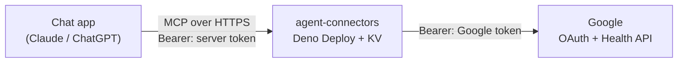
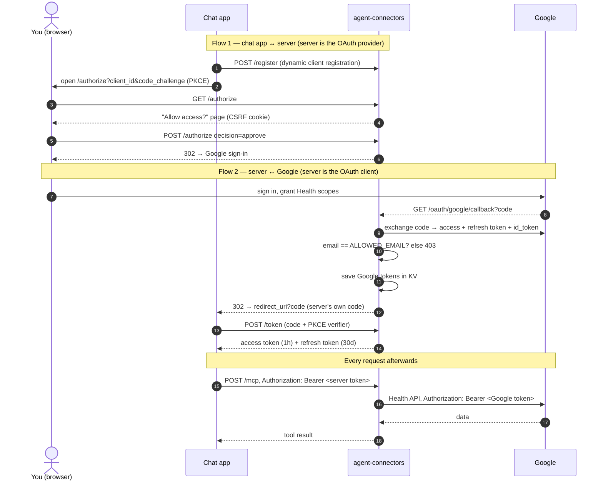

# agent-connectors

Personal chat connectors (remote MCP servers) built with Deno. The first one lets
ChatGPT or Claude read your data from the Google Health app.

## Tools

| Tool | What it does |
|---|---|
| `list_data_types` | Readable data types, grouped by category, with supported modes |
| `get_health_data` | One type over a date range (`raw`, `merged`, `daily`, `total`, or `auto`) |
| `get_daily_summary` | Steps, distance, exercise, sleep, resting HR, HRV, weight, hydration for a day |

## One-time setup

Follow [setup/google.md](setup/google.md): Deno Deploy app + KV, Google Cloud project
(Health API, consent screen, test user, scopes, OAuth client), then these env vars in Deno Deploy:

| Name | Value |
|---|---|
| `GOOGLE_CLIENT_ID` | from the Google OAuth client |
| `GOOGLE_CLIENT_SECRET` | from the Google OAuth client |
| `ALLOWED_EMAIL` | your Google account email |
| `BASE_URL` | your app URL, e.g. `https://my-health.kolodkin.deno.net` |
| `TZ` | your IANA timezone, e.g. `Asia/Jerusalem` (default `UTC`) |

Connector URL for Claude or ChatGPT: `<BASE_URL>/mcp`. You'll see this server's own *Allow access?* page
first — approve only connectors you just added — then sign in with your Google account.

**Weekly re-login:** while the Google app is in *Testing*, Google expires its refresh token after 7 days.
The server then asks your chat app to reconnect; sign in again.

## How it connects



Two independent OAuth flows. The chat app only ever holds tokens issued by this
server; Google tokens never leave the server's KV store.



What stops a stranger: `/mcp` needs a server token; a server token is issued only
after you click *Approve* **and** sign in to Google as `ALLOWED_EMAIL`; Google's
*Testing* mode additionally rejects any account not on the test-user list.

## Development

```bash
deno task test    # offline test suite
deno task check   # type-check
deno task dev     # run locally on :8000 (needs the env vars above)
```

Try it with MCP Inspector: `npx @modelcontextprotocol/inspector`, transport *Streamable HTTP*, URL `http://localhost:8000/mcp`.
